# How the fuel planner works

The diagrams are Mermaid: GitHub renders them, and so does VS Code with a Mermaid preview
extension. Each one is followed by its steps in plain words.

1. [Components](#1-components)
2. [A trip request, step by step](#2-a-trip-request-step-by-step)
3. [Resolving start and finish](#3-resolving-start-and-finish)
4. [Getting the route: cache, providers, circuit breaker](#4-getting-the-route-cache-providers-circuit-breaker)
5. [From the route line to candidate stations](#5-from-the-route-line-to-candidate-stations)
6. [Choosing where to fuel up](#6-choosing-where-to-fuel-up)
7. [Pricing, saving and the map page](#7-pricing-saving-and-the-map-page)
8. [Where each error comes from](#8-where-each-error-comes-from)
9. [Data model and main types](#9-data-model-and-main-types)
10. [The offline data pipeline](#10-the-offline-data-pipeline)
11. [Caches at a glance](#11-caches-at-a-glance)

---

## 1. Components

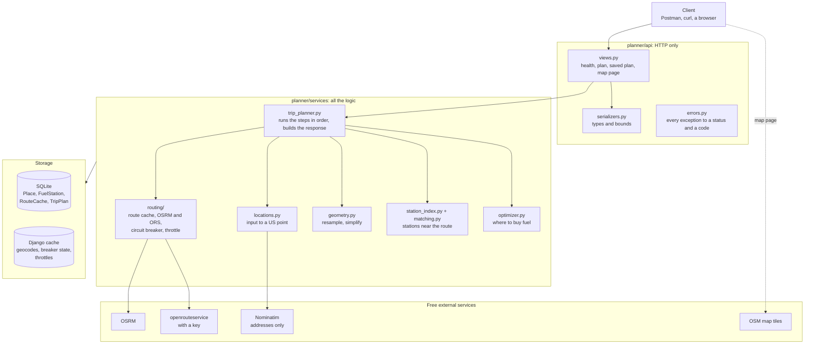

- **The API layer only speaks HTTP.** Views validate the input with a serializer, call
  one service function and return its result. They hold no business logic. DRF hands
  any exception to `errors.py`, and the saved-plan and map views read `TripPlan` rows.
- **`trip_planner` is the conductor.** It calls the other services in order and builds
  the response. Each of them does one job and knows nothing about HTTP.
- **`optimizer` has no Django imports at all,** which is why the tests can check it
  against an exact linear-programming solver.
- **Only three things leave the server:** the routing call (OSRM, or ORS as the
  fallback), a Nominatim search for free-text addresses, and the map tiles, which the
  browser fetches itself.

---

## 2. A trip request, step by step

`POST /api/v1/trips/plan/` with `{"start": "New York, NY", "finish": "Los Angeles, CA"}`.
The `GET` alias does the same with query parameters.

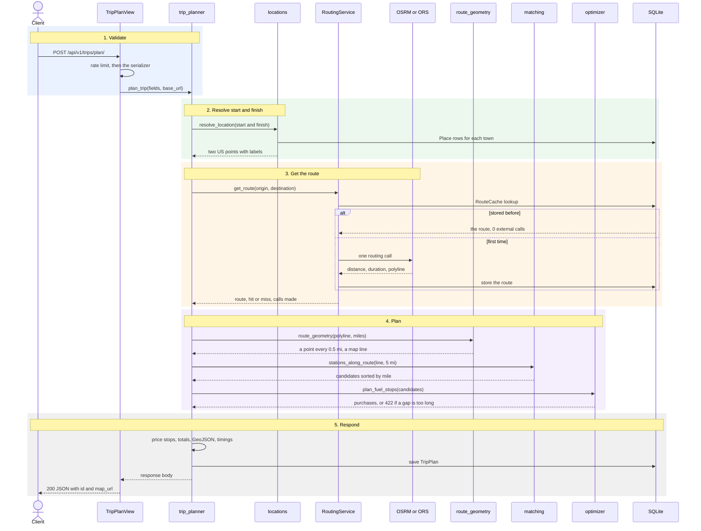

1. **Validate.** The rate limit (60 requests a minute per client) runs before anything
   else. The serializer then checks types and bounds (range 50 to 2,000 mi, mpg 1 to 100,
   corridor 0.5 to 25 mi, start fuel no more than the tank) and fills in the defaults:
   500 mi, 10 mpg, a full tank, a 5-mile corridor. A bad request stops here with 400
   `invalid_request`.
2. **Resolve.** Each place becomes a coordinate inside the USA (section 3). "City, ST"
   costs no network call. If start and finish are less than a mile apart: 400.
3. **Route.** One call to OSRM the first time, none afterwards (section 4).
4. **Plan.** The route line becomes evenly spaced mile markers, the stations within
   5 miles of it become candidates (section 5), and the optimizer picks the purchases
   (section 6). The station index behind the matching is built once per process.
5. **Respond.** Gallons and costs are rounded exactly as shown, the response is saved
   as a `TripPlan`, and `map_url` points at its map page (section 7).

Typical timings: about 1.2 to 1.5 s for a cold New York to Los Angeles, almost all of it
the OSRM call; a few milliseconds once the route is stored.

---

## 3. Resolving start and finish

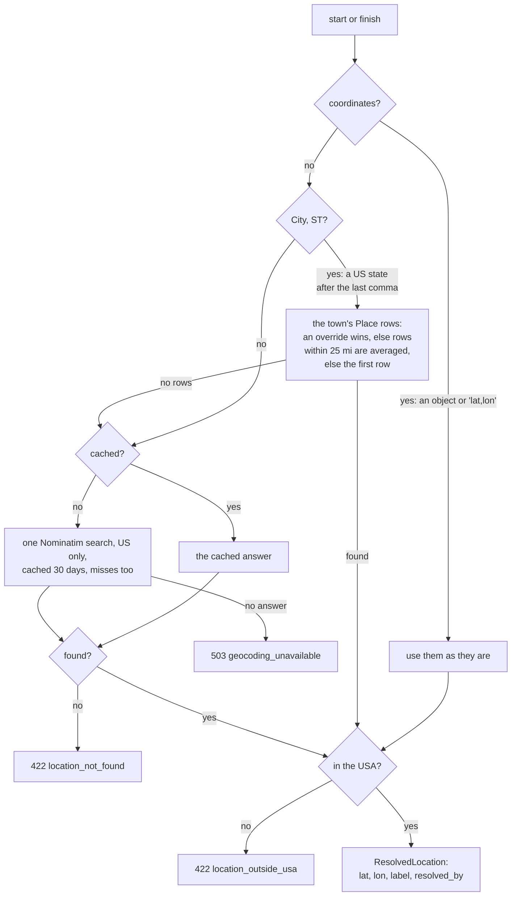

- **Cheapest first.** Coordinates need nothing, a town needs one indexed query, and only
  a street address or a ZIP code costs a Nominatim call.
- **Towns follow the stations' rules.** "City, ST" goes through the same
  `normalize_town()` and `resolve_town()` as the station import, so "St. Louis, MO" and
  "Saint Louis, missouri" land on the same point.
- **The cache key** for a free-text address is `geo:` plus a SHA-1 of the lowercased,
  space-collapsed text, so "1 Main St" and "1  main st" share one answer.
- **The US check is a set of rough boxes** around the lower 48, Alaska and Hawaii. They
  stop Paris or Mexico City, but a point just across a border gets through. Start and
  finish must both pass it.

---

## 4. Getting the route: cache, providers, circuit breaker

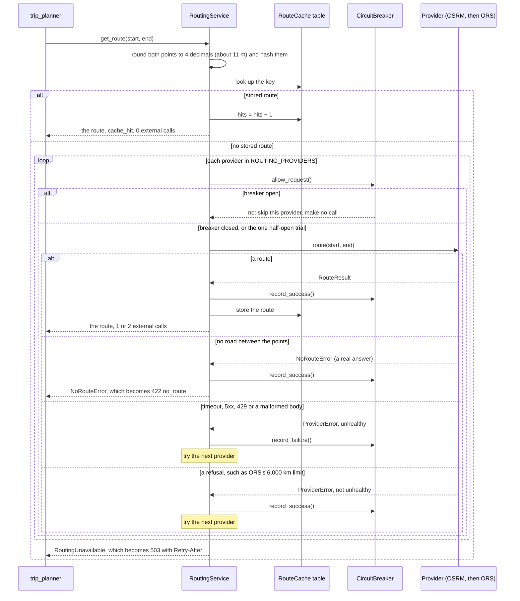

1. **The key** is a SHA-256 of `driving|lat,lon|lat,lon` with both points rounded to 4
   decimals, so requests for the same trip share one stored route.
2. **A stored route costs no external call.** The `hits` counter goes up, which the
   admin shows.
3. **Otherwise the providers are tried in order,** OSRM first and ORS second, ORS only
   when `ORS_API_KEY` is set. A failing provider hands over to the next instead of being
   retried, which keeps the latency predictable.
4. **"No road" is an answer, not a failure.** It is returned at once (422) and never
   failed over or counted against the provider.
5. **The call budget:** normally 1 routing call, 2 when OSRM fails and ORS answers, plus
   1 Nominatim call when an input is a free-text address.
6. **OSRM's policy is one request a second.** An outbound throttle sleeps out the rest
   of the second when two cold requests come close together.

### The circuit breaker, per provider

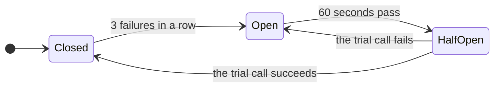

- **Closed:** calls go through. Failures in a row are counted, and any success resets
  the count.
- **Open:** calls are skipped, so the provider is not contacted at all, and the request
  moves straight on to the next provider.
- **Half-open:** exactly one trial call goes through (`cache.add` lets only the first
  caller in); the others keep skipping until it reports back.

The breaker's state lives in Django's cache, so every thread shares it. Only the
provider's own trouble counts as a failure: a timeout, a connection error, a 5xx, a 429
or a body we cannot read. `/health` shows each provider's state: `closed`, `open`,
`half_open`, or `disabled` for ORS without a key.

---

## 5. From the route line to candidate stations

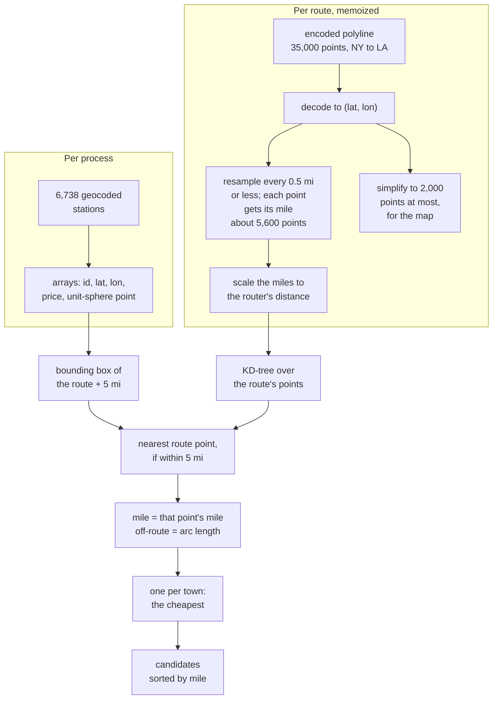

What the corridor search sees, seen from above:

```text
   - - - - - - - - - - - - - - - - - - - - - - - - - - - -   5 mi from the route
                    B  3.1 mi off: kept                X  6 mi off: dropped
   o--o--o--o--o--o--o--o--o--o--o--o--o--o--o--o--o--o--o-->  route, a point every 0.5 mi
   0 0.5 1                 |
                           +- B's nearest point: B is a candidate at this point's mile
   - - - - - - - - - - - - - - - - - - - - - - - - - - - -   5 mi on the other side
```

1. **Resample.** The router's line has uneven spacing, from metres in cities to miles on
   the interstate. Resampling gives a point every half mile (`np.interp` over the
   cumulative distance), so each point carries a mile marker. The markers are scaled to
   the router's distance, because that is what the truck actually drives.
2. **Measure on a sphere.** Turning latitude and longitude into points on a unit sphere
   lets an ordinary KD-tree find the nearest route point. A distance of 5 miles becomes
   the chord `2 sin(5 / 2R)`, with R = 3,958.8 mi.
3. **Prefilter.** The bounding box drops most of the country with plain array
   comparisons before any distance maths. The box widens east and west by `1/cos(lat)`,
   because a degree of longitude shrinks towards the pole.
4. **Match.** One query finds every station's nearest route point within the corridor.
   That point's mile becomes the station's mile marker, and the chord becomes its
   distance off the route.
5. **One per town.** Stations are placed at their town's centre, so several can share a
   coordinate. Only the cheapest of them could ever be chosen, so the rest are dropped.

The route work takes about 60 ms the first time and is then memoized (32 routes per
process). Matching takes a few milliseconds.

---

## 6. Choosing where to fuel up

The rule, applied at every station the truck stops at:

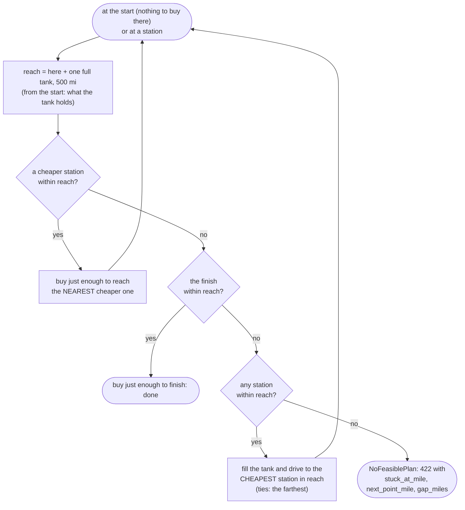

**Why this is the cheapest possible plan.** Every mile burns fuel bought somewhere in the
500 miles before it. The cheapest that mile can ever cost is the cheapest station in that
window, and this rule always pays exactly that. It is the classic "gas station problem"
(Khuller, Malekian and Mestre, *To Fill or Not to Fill*). The tests check it against an
exact linear-programming solver on 300 random trips.

**The worked example.** 1,100 miles, a full 50-gallon tank, stations A to E:

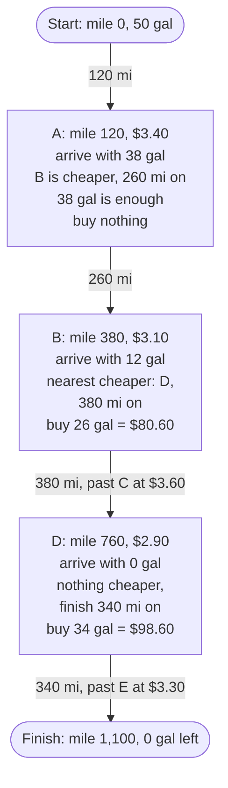

Total: **$179.20**. A, C and E are passed without buying.

**Why "nearest cheaper" and not "cheapest in range".** With an empty tank at a $3.00
station, $2.50 at +100 mi and $2.00 at +400 mi: driving straight to the cheapest
station in range costs $120, while this rule costs $105. It buys 10 gal at $3.00 to reach
the $2.50 station, then 30 gal there to reach the finish.

**What the model leaves out.** Stopping is free, so the plan will stop for a few gallons
to save a few cents a gallon (New York to Los Angeles has 14 stops). Detours to the
stations are not modelled; each stop reports how far it is from the route.

---

## 7. Pricing, saving and the map page

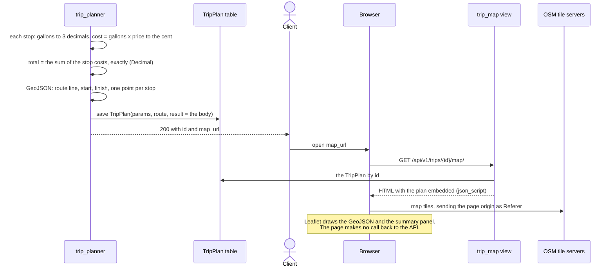

- **The arithmetic is checkable.** Every cost is computed from the gallons as shown, so
  a client can redo any stop, and `total_fuel_cost` equals the sum of the stops to the
  cent.
- **Plans are saved.** `GET /api/v1/trips/{id}/` returns the saved body without planning
  again, and the map page reads the same row.
- **The `map` field is plain GeoJSON** with `[lon, lat]` positions and `properties.kind`
  set to `route`, `start`, `finish` or `fuel_stop`. It pastes straight into geojson.io.

---

## 8. Where each error comes from

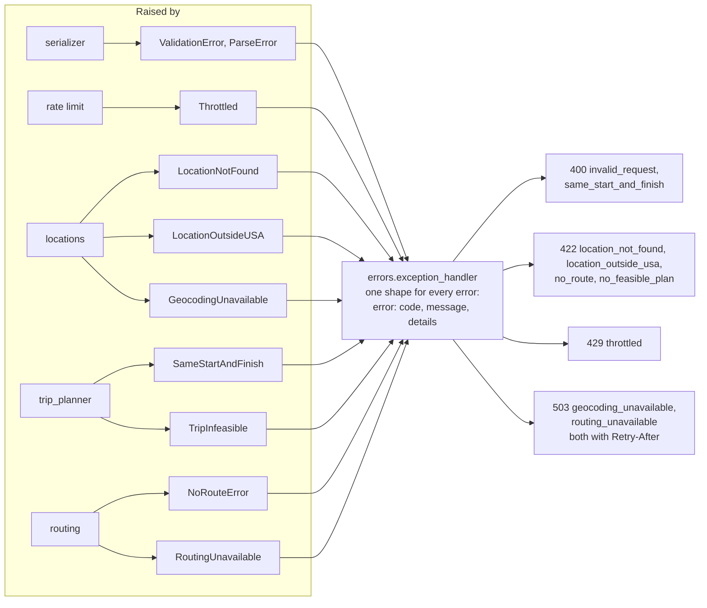

The services raise plain Python exceptions and never import from the API layer. One
table in `api/errors.py` gives each an HTTP status and a stable code that clients can
branch on.

---

## 9. Data model and main types

### Tables

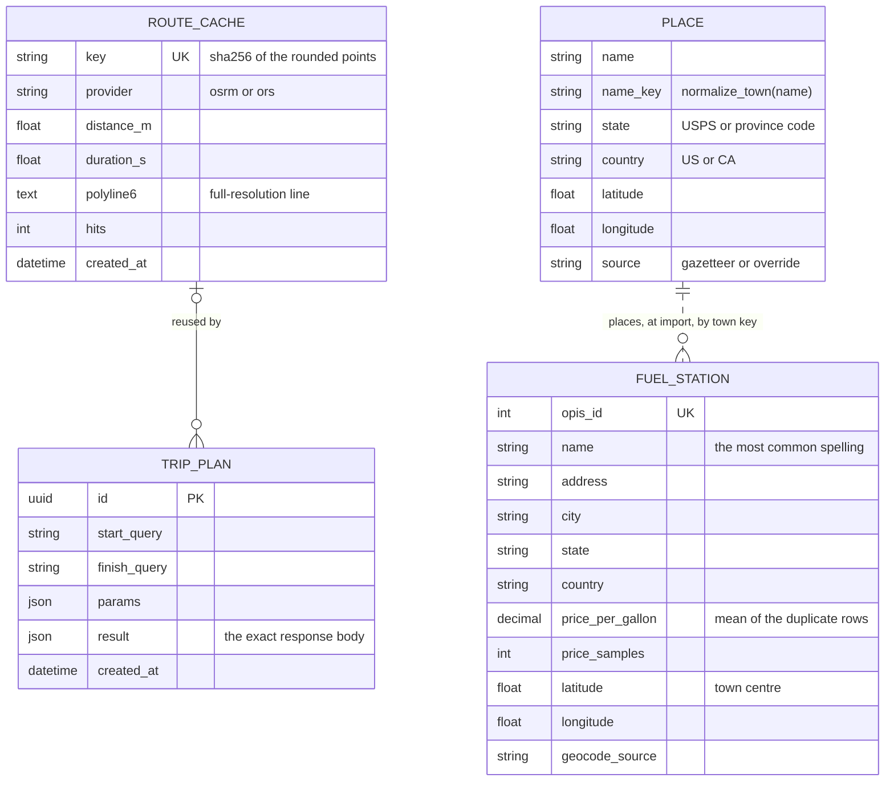

`Place` and `FuelStation` are not linked by a foreign key: the import gives each station
its town's coordinates once, offline, and no request geocodes a station.

### Routing types

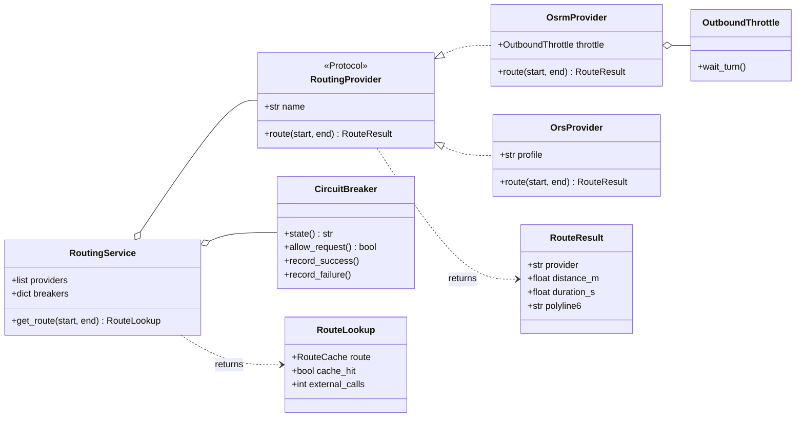

### Planning types, in the order the pipeline produces them

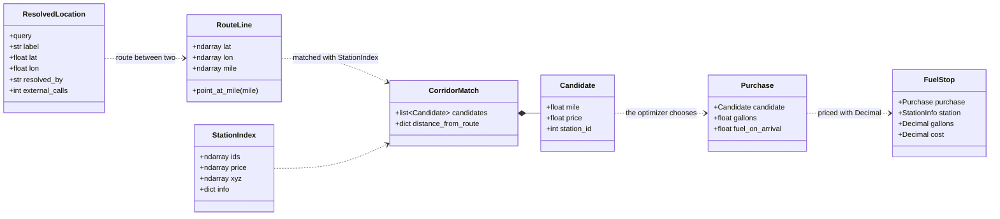

---

## 10. The offline data pipeline

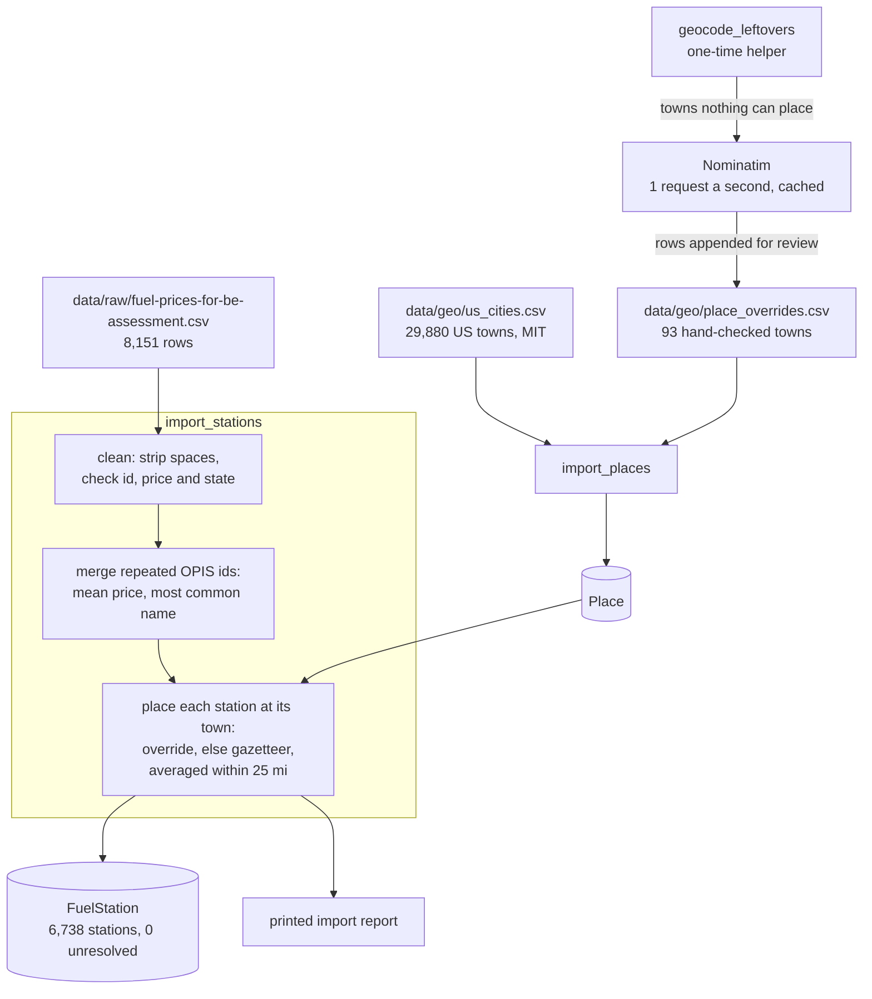

1. **`import_places`** loads the gazetteer and the overrides into `Place`, in one
   transaction.
2. **`import_stations`** cleans the price file, merges the 678 repeated station ids,
   places every station at its town and prints a report. It fails if more than 0.5% of
   the stations cannot be placed.
3. **`geocode_leftovers`** was run once to find the towns the gazetteer lacks. Its
   answers are committed in `place_overrides.csv`, so a reviewer never needs it.

After an import, restart the server: the station index is built once per process.

---

## 11. Caches at a glance

| What | Where | Kept for | It saves |
|---|---|---|---|
| Routes | `RouteCache` table | for good | the routing call on every repeated trip |
| Free-text geocodes | Django cache, `geo:<sha1>` | 30 days | a Nominatim call for a repeated address |
| Station index | process memory (`functools.cache`) | the process | a database query per station |
| Route geometry | process memory (`lru_cache`, 32 routes) | the process | about 60 ms of decoding on each warm request |
| Breaker state, throttles | Django cache | short | shared by every thread of the process |
| Database connection | `CONN_MAX_AGE`, 600 s | 10 minutes | SQLite's file set-up on every request |
